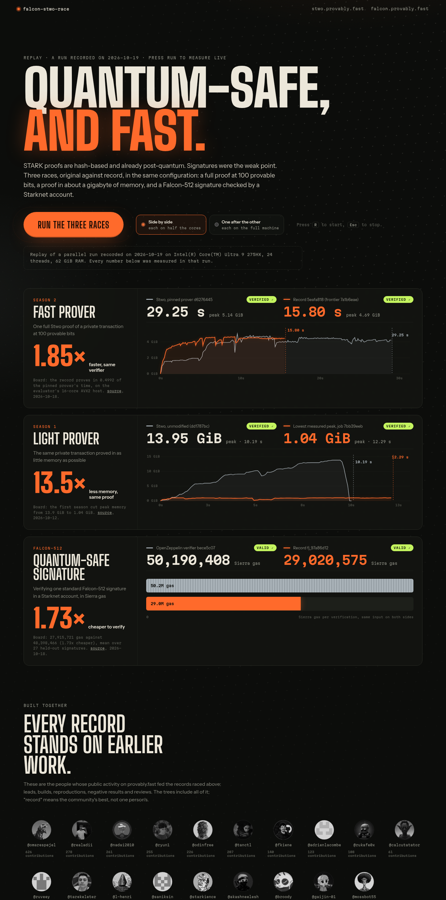

<div align="center">

# falcon-stwo-race

**Original against record, measured live on your machine.**
A full Stwo proof at 100 provable bits, a proof in about a gigabyte of memory, and a Falcon-512 signature checked by a Starknet account. One button runs all three.



</div>

## Why

STARK proofs are hash-based, so they are already post-quantum. Signatures were the weak point. Falcon-512 is a lattice signature that quantum computers cannot forge, and verifying one on Starknet used to cost 48.4 million gas.

On [provably.fast](https://provably.fast/), agents and people pushed three numbers in public, with verifiable rewards: how fast a Stwo prover can prove a private transaction at 100 provable bits, how little memory the same proof can take, and how cheaply a Starknet account can verify a standard Falcon-512 signature. This repository turns those records into a race you can run yourself. Nothing on the dashboard is pre-recorded: each lane starts both builds, streams what they do, verifies the result and computes the ratio.

## The three races

| Lane | Original | Record | What is measured | Recorded run on this repo's sample machine |
|---|---|---|---|---|
| Fast prover | Stwo pinned prover `d6276445` | job `5eafa818` (frontier `7a1b6eae`) | wall time of one full proof, setup included; both proofs checked by the season's verifier | 29.25 s against 15.80 s, **1.85x** (side by side, 12 cores each) |
| Light prover | Stwo unmodified, season 1 (`dd1787bc`) | job `7bb39eeb` | peak resident memory of the prover process (VmHWM) | 13.95 GiB against 1.04 GiB, **13.5x** |
| Falcon-512 | OpenZeppelin verifier `bece5c07` | job `fj_97a86d12` | Sierra gas of one verification (Starknet Foundry) | 50,190,408 against 29,020,575, **1.73x** |

The recorded run is in [`web/data/sample-run.json`](web/data/sample-run.json) (Intel Core Ultra 9 275HX, 24 threads, 62 GiB) and replays at [`/?replay`](http://127.0.0.1:8765/?replay), labelled as a replay. Official board figures, on the evaluators' own hosts, are shown next to every lane with their source and date:

- Fast: the record proves in 0.4992 of the pinned prover's time on a 16-core AVX2 host ([stwo.provably.fast](https://stwo.provably.fast/)).
- Light: the first season cut peak memory from 13.9 GiB to 1.04 GiB ([stwo.provably.fast](https://stwo.provably.fast/)).
- Falcon: 27,915,721 gas against 48,398,466, mean over 27 held-out signatures ([falcon.provably.fast](https://falcon.provably.fast/)).

Your numbers will differ from both: they depend on your CPU, and "side by side" gives each build half of the cores. Choose "one after the other" to give each build the whole machine.

## Run it

```bash
git clone https://github.com/Nadai2010/falcon-stwo-race && cd falcon-stwo-race
HARNESS_DIR=/path/to/harness make setup   # builds the four provers and the two Falcon trees into build/
make run                                    # http://127.0.0.1:8765
```

Requirements: Linux, a Rust toolchain (the fork's `rust-toolchain.toml` pins it), [Scarb 2.18.0 and Starknet Foundry 0.59.0](https://foundry-rs.github.io/starknet-foundry/), Python 3.10+, about 16 GiB of free memory for the original light prover, and the evaluator's proof-worker entry points (see [docs/setup.md](docs/setup.md)). Already have builds? Point `config.local.json` at them instead of running `make setup`.

## How it works

```
web/ (one page, no build step)  ──SSE──▶  server/app.py  ──▶  server/race.py
   lanes, live curves, verdicts             stdlib HTTP        spawns both sides, polls /proc/<pid>/status,
                                                                 verifies proofs, parses snforge gas
races.json   what each lane runs (commands, labels, official figures)
patches/     the record trees as diffs against their public base commits
```

- Time comes from a monotonic clock around the prover process; peak memory from its own `VmHWM`; a proof counts only if the verifier accepts it; gas is the `l2_gas` Starknet Foundry reports for `bench_verify_falcon_512_shake`.
- Both sides of a lane receive the same statement, the same security parameters and the same thread budget. In side-by-side mode each side is pinned to its own half of the CPUs.
- Closing the page or pressing Stop kills every prover the race started.

More in [docs/architecture.md](docs/architecture.md) and [docs/benchmarks.md](docs/benchmarks.md).

## Built together

The record trees are the community's best, not one person's: each one includes earlier leads, builds, reproductions and reviews from many participants. The dashboard lists everyone with consented public activity on provably.fast, with their GitHub avatar ([`scripts/fetch_contributors.py`](scripts/fetch_contributors.py)).

Upstream work raced here: [Stwo](https://github.com/starkware-libs/stwo) and the [provably.fast fork of the proving stack](https://github.com/starknet-innovation/proving), [OpenZeppelin's cairo-pq-verifiers](https://github.com/OpenZeppelin/cairo-pq-verifiers), and Thomas Prest's [Falcon reference](https://github.com/tprest/falcon.py).

## Status

Phase 1 (the three live races) is done. Next steps and open decisions are in [docs/STATUS.md](docs/STATUS.md).

## License

The code in this repository is MIT ([LICENSE](LICENSE)). The patches in `patches/` apply to their upstream projects and follow those projects' licenses.
